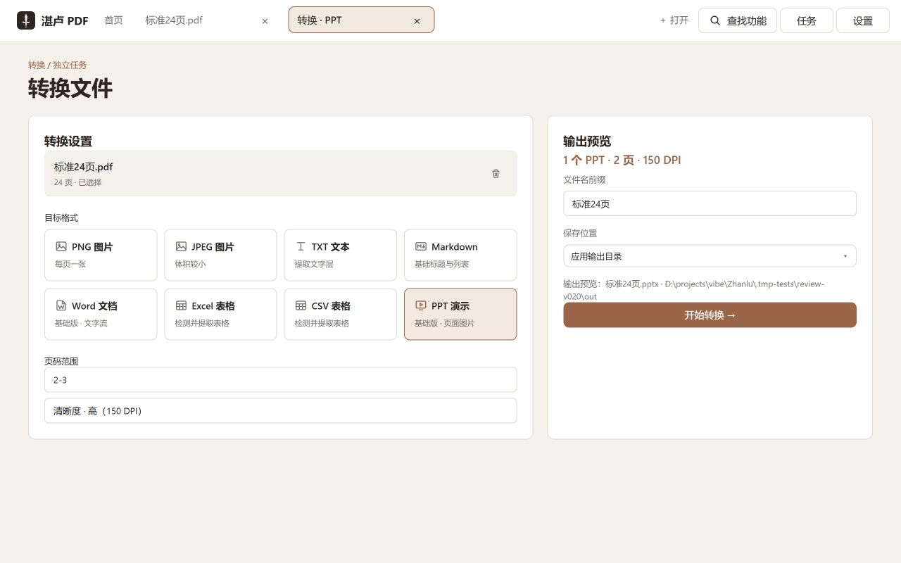
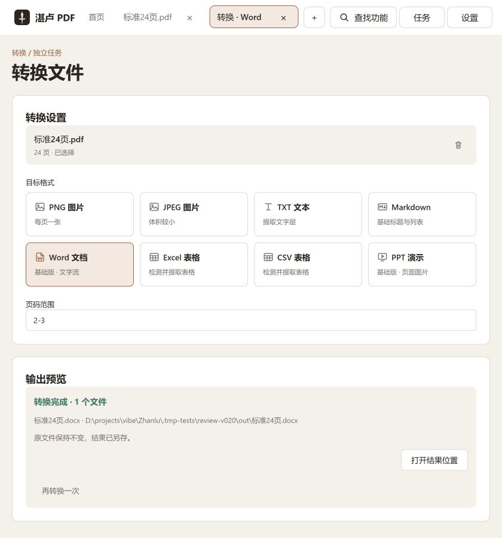
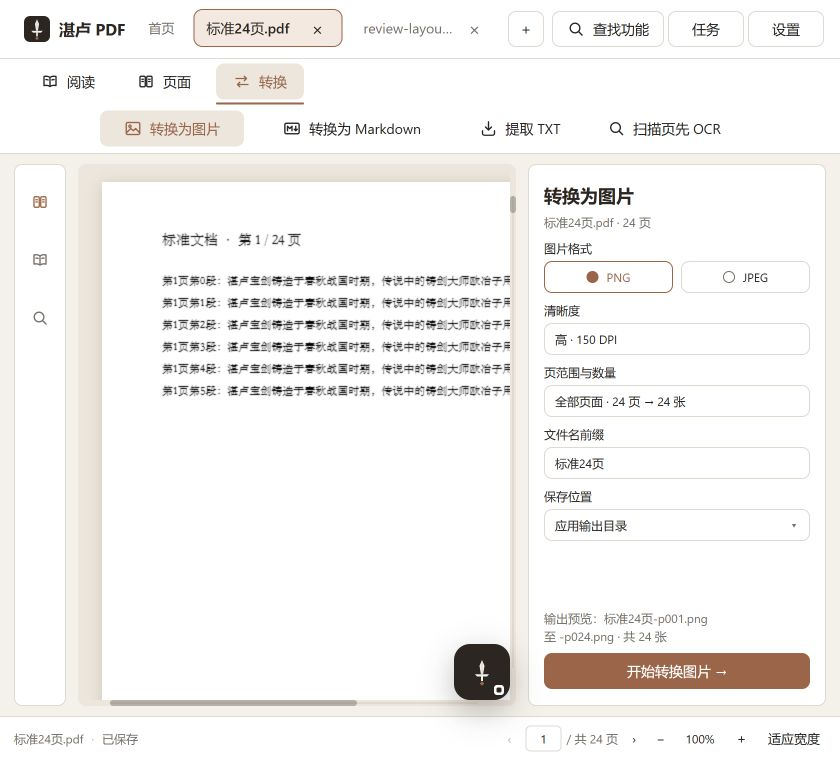
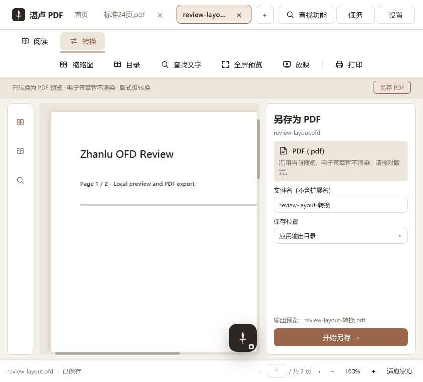
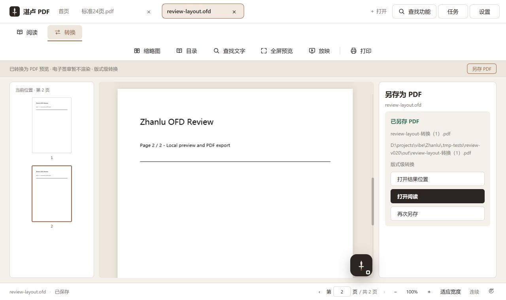
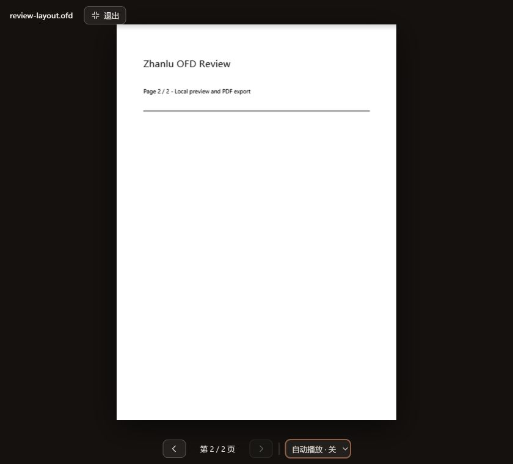

# v0.2.0 功能 界面与架构 Review

评审时间：2026-10-31 至 2026-11-01。结论：现有三层技术分工适合本地桌面产品，可以保留。本轮已修复实际发现的转换、OFD、交互与图标问题；以下验证不代替整版发布验收，也没有重新打包安装程序。

## 已修复问题

| 优先级 | 问题与触发条件 | 修复 |
| --- | --- | --- |
| P1 | OFD 缺少可匹配字体时，缺省字体未注册；绘制异常被忽略，预览可能只剩线条却报告成功 | 使用已注册中文字体；部分对象绘制失败写入结果说明；升级缓存版本，使旧缺字预览失效 |
| P1 | 同一 OFD 被同时打开，重复转换争用同一缓存，Windows 出现文件占用错误 | 按内容串行构建缓存；缓存同时保存转换说明，命中时保留文字重建等降级信息 |
| P1 | OFD 标签重启丢失，OFD 深链不能打开，恢复上次 PDF 还可能覆盖深链目标 | PDF/OFD 共用恢复规则，明确深链优先并保存当前文档 |
| P1 | PPT 将竖版或不同比例页面拉伸成 16:9 | 保留 16:9 幻灯片，页面图片按原比例居中完整适配 |
| P1 | Excel/CSV 只检测前 8 页；第 9 页之后才出现表格时无法执行 | 前 8 页未发现表格就继续分块检查，全部所选页均无表格才拦截；执行仍检查所选全部页 |
| P2 | 阅读内转换混入全部 Office 目标，违背独立转换入口范围 | 阅读内恢复图片、Markdown、TXT 上下文；Office 仅保留在独立任务页 |
| P2 | OFD 无目录或搜索无结果时出现 AI/OCR 操作 | 移除 OFD 的 AI 目录入口和 OCR 引导，增加处理函数的格式检查 |
| P2 | 全屏控制使用字符图标，键盘无法稳定唤醒控制条，选择自动播放时快捷键可能同时翻页 | 共用 SVG 图标；键盘唤醒、焦点循环、退出恢复焦点；选择框独立处理按键；自动播放到末页立即停止 |
| P2 | 窄窗口八种格式占四行、格式名称不直观、控件拥挤 | 四列两行、等宽卡片、统一格式图标，明确 TXT/JPEG 和基础版边界；删除重复流程解释 |
| P2 | OFD 完成态缺实际文件名，多个操作在右栏挤成折行小按钮 | 显示实际名称与路径；等宽纵排操作，仅一个主要动作；提供打开结果阅读 |
| P2 | OFD 失败态仍显示正在转换，且无就地重试 | 明确失败状态并添加重试预览；保留原因 |
| P2 | 新格式切换仍显示上次转换成功结果、运行期间输入可修改 | 切换目标清除旧完成态；运行期间禁止更换输入和目标；补充格式组方向键操作 |
| P2 | 引擎运行版本仍为 0.1.0，CSV 被登记为未知类型 | 对齐 0.2.0 版本并登记 CSV 类型 |

## 图标交付

补充 11 个 SVG：全屏、放映、文件、文本、Word、表格、上一页、下一页、加、减、退出全屏。统一 24×24 viewBox、1.8 描边、圆角端点、currentColor；接入已有旋转图标。Excel/CSV 共用表格图标，PPT/放映共用演示图标。`assets/icons` 成为前端唯一图标来源，消除源码路径与资产文件两份维护的问题。

## 画板与实现映射

已阅读现行交接词、设计索引、交互说明、产品定义、流程和验收；实际读取 Figma `06` 中 112、122、124、125 的图层上下文或画面。未修改 Figma，也未使用 `03`、`04` 历史画板覆盖现行布局。

| 现行场景 | 实现 |
| --- | --- |
| 33 首页 | Home、Spine、App |
| 34 阅读；45 窄窗口阅读 | Reader、PageViews、Spine |
| 35 合并；43 拆分 | MergeTask、SplitTask |
| 36 独立转换 | Convert；本轮对应 112/122 的卡片、字段与保存布局 |
| 37/49 AI；44 OCR | AiChat、Reader 的扫描页引导 |
| 38/39 设置；50/51/53/54 远程连接 | Settings |
| 40 阅读内转换 | ReaderConvertPanel；本轮对应 124/125 的专属目标右栏 |
| 41/47 文内搜索 | Reader 的 SidePanel 与文字层高亮 |
| 42 页面网格 | PagesGrid |
| 46 状态 | useJob、SwordProgress、各任务结果与错误态 |
| 48/56/57/58 全局查找 | Spine 的命令分组、限高列表、键盘与焦点恢复 |
| 52/55 发送确认 | AiChat 与 Reader 的逐文档授权 |
| v0.2 OFD/全屏/放映/Office | 产品文档定义能力，延续 06 的字段、按钮、色彩及布局规律 |

与旧画面有意不同：独立转换由四种格式扩为八种，在 1280/840 px 使用两行等宽卡片；OFD 右栏与全屏/放映没有专属现行画板，按产品范围实现。真实 PDF 内容、页数、输出路径、编号和任务状态使用本轮实际数据。这里没有宣称全部画板均已逐像素验收。

## 实际操作与截图

1. 首页与打开文件：已核查；PDF/OFD 标签可区分，入口文案覆盖 OFD。
2. 独立转换：已通过；Word 选第 2–3 页实际生成文件，切换格式清除旧完成态；方向键选择与焦点一致。
3. 无表格错误：已通过；阻止执行、保留页码与保存参数，显示实际检查范围。
4. 阅读内转换：已通过；1280/840 px 保留原文、左栏和底栏，右侧只显示当前目标，Office 不再混入。
5. OFD 预览与另存：已通过；两页文字和线条正常、签章限制明确；重复打开、另存编号和恢复可用。
6. 全屏与放映：已通过；840 px 键盘焦点循环、控制条唤醒、翻页、Esc 返回第 2 页并恢复入口焦点；5 秒自动播放到末页停止，选择框 Home 不翻页。
7. 全局查找：已核查当前文档范围、放映搜索结果与 Esc 关闭后恢复入口焦点；OFD 范围与最近文件已补齐。远程模型配置和发送确认没有在本轮重新执行完整 UI 验收。

## 验证结果与边界

- 前端类型检查与生产构建通过；主包约 1,016 KB，gzip 310 KB，pdf.js Worker 约 1,264 KB，仍有大包警告。
- 引擎 108 项测试通过，覆盖安全、任务恢复、输出、AI 合同，以及新增的后置表格、PPT 比例、OFD 缺字/并发缓存/降级说明回归。
- 前端原生拖放 11 项测试通过。
- 实际 API 检查 PNG/JPEG/TXT/Markdown/DOCX/XLSX/CSV/PPTX 八种输出、OFD 预览与另存、重复输出自动编号；检查 Office 内容、幻灯片比例、页数以及源文件 SHA-256 未改变。记录见本地 `.tmp-tests/review-v020/api-results.json`。
- 视觉证据来自本轮 Windows Chrome 运行界面；内置浏览器无法访问本机环境，改用本机 Chrome。测试使用独立端口和仓库内测试数据。
- 没有重新验证安装包、WebView2 系统全屏/打印、物理打印、干净机器离线包、真实电子签章还原、完整远程模型发送确认，以及所有页面在 200% 系统缩放下的表现。Office 产物由对应文件解析库检查，本轮没有逐份打开 Word/PowerPoint 桌面程序验收。

## 架构评估与改进顺序

React/pdf.js 阅读、Python 文件处理、Tauri 桌面宿主的分工合理。保留文件 ID 授权、会话令牌/Host/Origin 校验、DPAPI、本地任务队列、非覆盖交付和算法 core 边界。原架构评审中的无鉴权、凭据混淆等问题不应继续被当成现状。

| 优先级 | 现状与依据 | 建议 |
| --- | --- | --- |
| P1 | `tasks.py` 使用线程池；`server.py:184` 只对缩略图按文件加锁，转换/OCR 的原生渲染仍在引擎进程中 | 将 PDF/OFD 解析与渲染放入受限工作进程，设内存/时间上限，崩溃只影响单任务；先审查统一原生渲染并发边界。本轮没有做进程崩溃压力验证 |
| P1 | OFD ZIP/XML 直接展开读取，上传 512 MB 上限不等于解压后资源上限 | 增加 ZIP 总展开量、单资源、条目数、图像像素及 XML 大小限制，使用异常文档与压缩炸弹样本验证 |
| P2 | 表格预览在 HTTP 请求里同步提取，找到表格前可能要检查全部所选页；前端防抖与序号守卫不会取消引擎已开始的计算 | 将重预览作为可取消任务，按文件内容/范围/算法版本缓存探测结果；重复输入共享正在运行的探测 |
| P2 | `waitTask` 无 AbortSignal，`useJob` 和各页面分别轮询；页面卸载后请求仍可能继续 | 建立统一任务订阅或轮询管理，卸载停止监听、增加短暂连接失败恢复，任务本身继续后台执行 |
| P2 | Reader 集中加载、OFD、搜索、目录 AI、OCR、打印和全屏；Spine 集中标签、菜单、命令与任务列表 | 按已有行为拆出文档会话、OFD 预览、搜索和任务订阅 hooks；引擎逐步拆 API、任务编排和文件交付服务，保持 core 纯算法；不为目录整齐整体搬迁 |
| P2 | 单一前端主包约 1 MB；转换任务草稿只在内存，刷新后消失 | 按阅读/AI/设置/独立任务延迟加载；明确任务草稿恢复策略，持久化必要的格式、范围和保存偏好 |

建议下一步先做原生渲染隔离和输入资源上限，再做异步预览与统一任务订阅，最后做模块拆分和首包优化。每一步沿用现有合同测试及真实产物检查，不需要替换 React、Python 或 Tauri。
